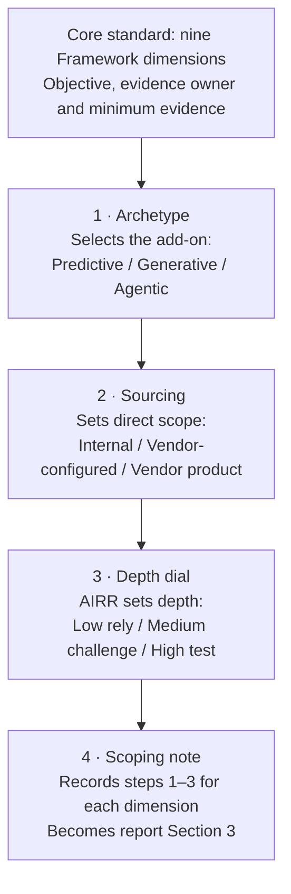

# AI Validation Matrix – Worked Example (Draft)

Oct 26, 2026 · @Ariel Gimenez

Every AI validation applies one core standard across the nine Framework dimensions (Section 6.3), then scopes it in four steps: the archetype sets the add-on tests, the sourcing model sets what UKRM examines directly, the AIRR sets the depth, and a scoping note records the result. Add-on tests are drafted for three dimensions so far: Output Accuracy and Reliability, Bias and Fairness, and Security and Adversarial Robustness.

## At a glance

Start from the core standard, then apply the four steps in order. The scoping note becomes Section 3 of the AI validation report.

## Core standard

The core applies to every AI use case, whatever its type or sourcing. It sets what UKRM must be satisfied of, who produces the evidence, and the minimum evidence expected, drawn from the Submission Pack (Framework 6.2).

| Dimension | What UKRM must be satisfied of | Evidence owner | Minimum evidence |
| --- | --- | --- | --- |
| AI Risk Coverage | All applicable risks in the AI Risk Register are identified, assessed, and mitigated or accepted | AI Use Case Owner | AI Risk Self-Assessment against Appendix 11, with a rationale for each risk |
| Output Accuracy and Reliability | Outputs are accurate, reliable and consistent enough for the intended use | AI Developer and Use Case Owner | Output testing evidence against acceptance thresholds set before testing |
| Explainability and Transparency | Outputs can be explained to the standard the use requires, including UK GDPR Article 22 and Consumer Duty for customer decisions | AI Developer | Explainability Assessment |
| Bias and Fairness | No unjustified disparate impact across protected characteristics | Use Case Owner; Compliance and Conduct Risk | Bias Pre-Assessment and proposed bias monitoring |
| Human Oversight and Accountability | Oversight is proportionate and genuine, SM&CR accountability is clear, and fallback procedures are tested | Use Case Owner | Human Oversight Plan; SM&CR Accountability Mapping; fallback procedures |
| Data Governance | Data is of adequate quality, appropriately sourced and processed on a valid lawful basis | Data Management; Data Protection Officer | Data Quality and Lineage Report; DPIA where required |
| Third-Party and Supply Chain Risk | Vendors are risk-assessed, contracts address AI-specific risks, and contingency plans exist | TPRM and Procurement | Third-Party AI Assessment and vendor AI governance documentation |
| Security and Adversarial Robustness | The system is protected against adversarial attacks and prompt injection, with appropriate access controls and logging | Information Security | AI Security Assessment signed off by the CIO or delegate |
| Regulatory Compliance | The use case complies with applicable law, and any regulatory notifications are identified | Compliance and Legal | Compliance and Legal assessment of the use case |

## Step 1 – Classify the archetype

The archetype selects the add-on: the tests that sit on top of the core for that type of AI. The Agentic add-on applies on top of the Generative add-on for any text an agent produces. A new archetype becomes a new add-on; the core stays unchanged.

| Dimension | Predictive AI add-on | Generative AI add-on | Agentic AI add-on |
| --- | --- | --- | --- |
| Output Accuracy and Reliability | Out-of-sample and out-of-time performance on labelled data; discrimination and calibration against thresholds; stability across key segments; sensitivity to input perturbation; benchmark against the incumbent process or a simpler model | Curated evaluation set covering intended use and edge cases; rubric-based human review; hallucination and groundedness rate; for RAG, retrieval quality and faithfulness to sources; consistency across repeated runs and prompt variants | Scenario-based testing in a sandbox; task completion rate; correctness of each tool call and intermediate step; error propagation across steps; behaviour on ambiguous or out-of-scope requests (stops or escalates rather than acts) |
| Bias and Fairness | Disparate impact on outcomes and error rates across protected characteristics; representativeness of training data; review of proxy variables | Counterfactual prompt testing (swapping names, gender, age); parity of tone and answer quality across customer groups; stereotyped or harmful content testing; representativeness of the retrieval corpus | Fairness of the actions taken (which cases are escalated, prioritised or declined); counterfactual testing of end-to-end scenarios |
| Security and Adversarial Robustness | Adversarial input perturbation; data poisoning controls in the training pipeline; access controls on the model and inference API; model extraction risk | Direct and indirect prompt injection, including through retrieved documents; jailbreak testing; system prompt leakage; sensitive data leakage in outputs; knowledge-base access respects user entitlements | Least-privilege tool permissions; injection leading to unauthorised actions; action and rate limits; kill switch and rollback; action logs complete enough to reconstruct what the agent did |

The add-ons for the remaining six dimensions are still to be drafted.

## Step 2 – Identify the sourcing model

Sourcing does not lower the standard; it sets what UKRM examines directly and what it covers through other evidence. The less the bank can see, the more weight falls on outcome testing, the Third-Party dimension and the monitoring plan.

| Sourcing model | In direct UKRM scope | Covered through other evidence |
| --- | --- | --- |
| Internally built (white box) | The full system, including development data, methodology and design choices | Nothing material |
| Configured on a vendor model (grey box) | Everything the bank controls (prompts, retrieval, guardrails, integration) and end-to-end outcome testing on the bank’s own use cases | The foundation model, through vendor documentation, the TPRM assessment and contractual rights |
| Vendor product (black box) | Outcome testing on the bank’s use, integration points, data flows, and the bank’s own controls and monitoring | System design and development, through vendor evidence, TPRM and contract terms |

How this applies to the three drafted dimensions:

| Dimension | Internally built | Configured on a vendor model | Vendor product |
| --- | --- | --- | --- |
| Output Accuracy and Reliability | Review the full development and evaluation methodology; UKRM may re-run tests on development data | Test the end-to-end system on the bank’s use cases; review prompts, retrieval and guardrails in depth; vendor benchmarks as supporting evidence only; retest when the vendor model version changes | Outcome testing on bank data (pilot or parallel run); vendor validation evidence; contractual right to information and change notification; greater reliance on monitoring |
| Bias and Fairness | Direct access to training data and features; test outcomes directly | Counterfactual testing of the full system; vendor bias evaluation for the foundation model; review of the bank’s retrieval corpus | Outcome testing on the bank’s population; vendor fairness documentation; compensating bias monitoring where protected-characteristic data cannot be tested |
| Security and Adversarial Robustness | InfoSec penetration testing and red-teaming of the full stack | Bank-side red-teaming of prompts, retrieval and integrations; vendor security attestations for model hosting; data residency and retention terms | Vendor attestations and TPRM security due diligence; contractual controls; bank testing of its own integration points and data flows |

## Step 3 – Apply the depth dial

The AIRR sets one depth for every dimension, combining reliance and proportionality in a single setting. At every depth, UKRM checks that other functions’ evidence covers AI-specific risks; a gap is raised as a finding.

| AIRR | Depth | What UKRM does |
| --- | --- | --- |
| Low | Rely | Confirms the evidence exists, is current for the version being deployed and covers AI-specific risks |
| Medium | Review and challenge | Tests the reasoning, scope and conclusions of the evidence; may re-perform a sample |
| High | Independently test | Reviews and challenges, then adds its own testing where the dimension is core to model risk |

Two fixed overrides:

- Customer-facing use cases take High depth on Bias and Fairness regardless of AIRR, because a clean bias assessment is a prerequisite for approval (Framework 6.3).
- Rely never means accepting a sign-off without checking its AI-specific scope.

What each depth means for the three drafted dimensions:

| Dimension | Rely (Low) | Review and challenge (Medium) | Independently test (High) |
| --- | --- | --- | --- |
| Output Accuracy and Reliability | Review 1st LoD test evidence and thresholds | Challenge test design and coverage; UKRM re-runs a sample of the evaluation set | UKRM builds or extends its own evaluation set and challenge scenarios |
| Bias and Fairness | Review methodology and coverage | Challenge protected-characteristic coverage; sample re-testing | Independent counterfactual or disparate impact testing |
| Security and Adversarial Robustness | Confirm the AI Security Assessment exists and covers AI-specific threats | Challenge scope, results and open actions | Confirm red-teaming of AI-specific attack vectors has been performed and remediated |

## Step 4 – Record it in a scoping note

The scoping note is agreed at the start of each validation and becomes Section 3 of the AI validation report. It records the result of Steps 1 to 3 so the depth and scope of work are visible before testing begins.

| Field | What it records |
| --- | --- |
| Archetype and add-on | The archetype classification and the add-on(s) applied |
| Sourcing model | Which parts of the system are in direct UKRM scope and which are covered through other evidence |
| AIRR and depth | The AIRR and the resulting depth for each of the nine dimensions |
| Overrides | Any fixed override applied, such as High depth on Bias and Fairness for customer-facing use |
| Evidence and owners | The evidence relied on for each dimension and the function that owns it |
| Independent testing | The specific UKRM tests planned where depth is Independently test, or where a sample is re-performed |
| Exclusions and limitations | Anything out of scope and why |

**Worked example:** an internal staff RAG assistant on a vendor LLM, rated Medium AIRR. It uses the core standard plus the Generative add-on. The bank’s prompts, retrieval and guardrails are in direct scope; the foundation model is covered by vendor and TPRM evidence. As it is not customer-facing, no override applies.

| Dimension | Depth | UKRM focus |
| --- | --- | --- |
| AI Risk Coverage | Review and challenge | Completeness of the self-assessment against the AI Risk Register |
| Output Accuracy and Reliability | Review and challenge | Evaluation set design and thresholds; UKRM re-runs a sample; retrieval quality and groundedness |
| Explainability and Transparency | Review and challenge | Source citation in answers, so staff can verify outputs |
| Bias and Fairness | Review and challenge | Counterfactual testing approach and retrieval corpus representativeness |
| Human Oversight and Accountability | Review and challenge | How staff review outputs before use; SM&CR mapping |
| Data Governance | Review and challenge | Knowledge-base sources, lineage and DPIA conclusions |
| Third-Party and Supply Chain Risk | Review and challenge | TPRM assessment; contractual change notification for model version updates |
| Security and Adversarial Robustness | Review and challenge | Coverage of prompt injection, data leakage and entitlement-aware retrieval in the AI Security Assessment |
| Regulatory Compliance | Review and challenge | Compliance and Legal view on internal use and data handling |
